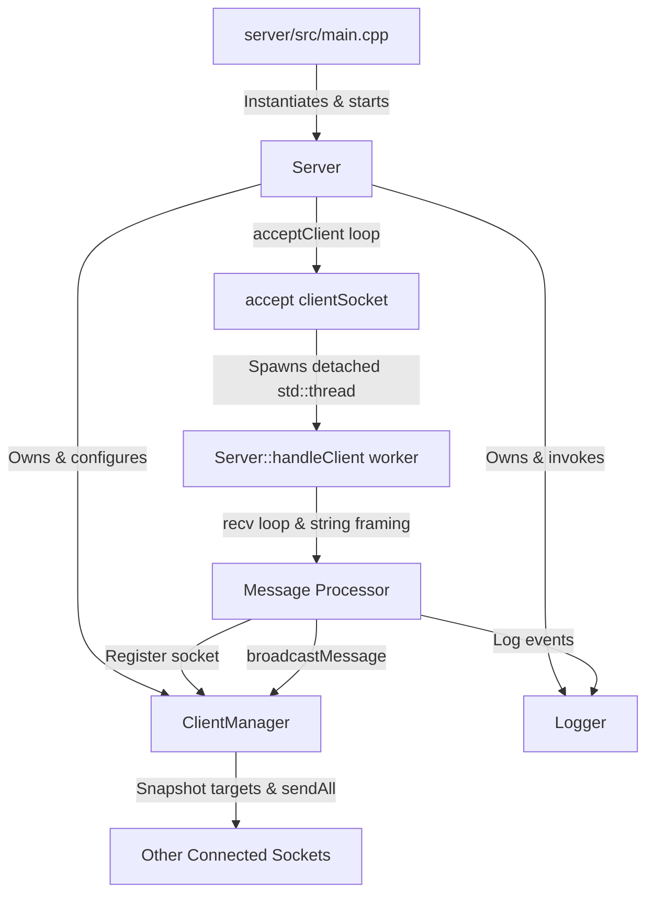
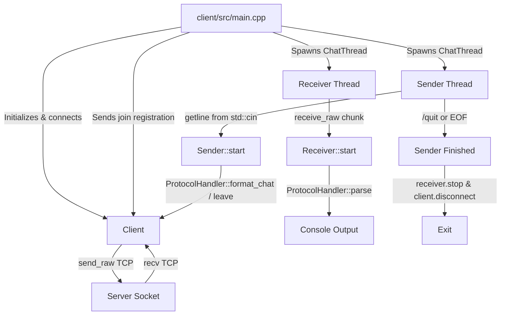
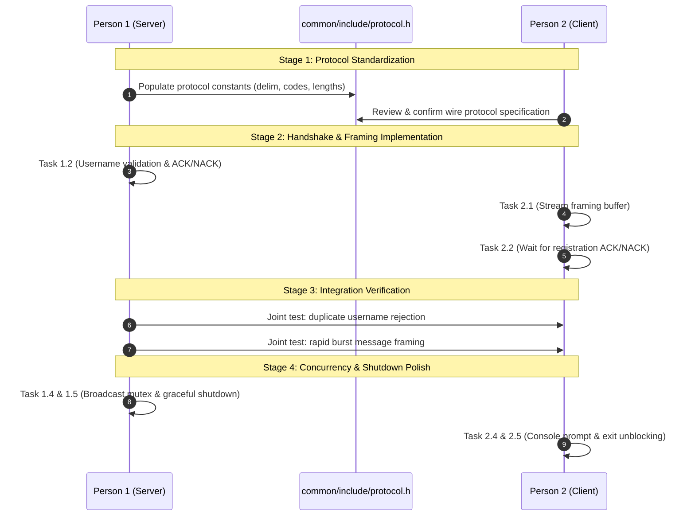
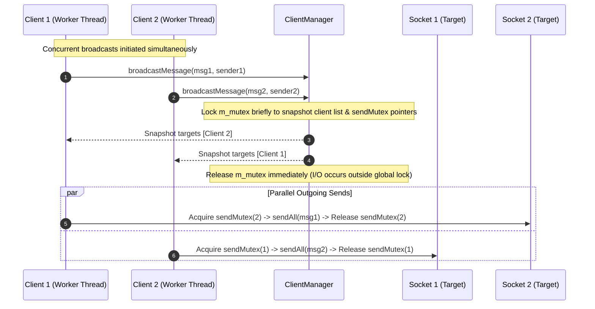

# Project Progress Report & Phase 2 Readiness Assessment

**Document Target:** `docs/PROJECT_PROGRESS_AND_PHASE2_READINESS.md`  
**Project:** C++ TCP Socket Multi-Client Console Chat Application  
**Current Branch:** `Server-side` (clean working tree, synced with `origin/Server-side`)  
**Assessment Date:** October 2026  
**Auditor:** Pair Programming Assistant (Antigravity)  

---

## 1. Executive Summary

This report delivers a comprehensive, factual code audit and architecture assessment of the **C++ TCP Multi-Client Chat Application** before starting Phase 2. The codebase implements a centralized client-server chat architecture over TCP stream sockets targeting Windows using Microsoft Winsock2 and C++17.

### High-Level Status
The Phase 1 prototype is **substantially implemented and functional for primary happy-path scenarios**:
- The server binds to `0.0.0.0:8080`, listens, and accepts multiple concurrent client TCP connections via a thread-per-client model.
- Connected clients can transmit their username, receive system broadcast announcements, exchange broadcast messages across all peers, and disconnect gracefully using `/quit`.
- All connection events, messages, and warnings are logged to a thread-safe, persistent file (`logs/chat.log`).
- The project compiles with zero warnings under GCC 16.1.0 (`-std=c++17 -lws2_32`).

### Critical Findings Requiring Remediation Before Phase 2
Despite core functional progress, the repository exhibits architectural discrepancies, missing safety boundaries, and concurrency hazards:
1. **Shared Protocol Non-Exclusion (`common/include/protocol.h`):** Although documented as the shared contract between Person 1 and Person 2, `common/include/protocol.h` contains only 3 lines of comments and zero declarations. The client implements an ad-hoc protocol in [client/include/protocol_handler.h](file:///c:/Users/harsh/OneDrive/Desktop/OOP-CP/client/include/protocol_handler.h), while the server relies on hardcoded string slicing in [server/src/server.cpp](file:///c:/Users/harsh/OneDrive/Desktop/OOP-CP/server/src/server.cpp).
2. **Missing Message Framing on Client:** While the server correctly buffers incoming TCP byte streams and slices complete messages at `\n` boundaries, the client's [Receiver::start()](file:///c:/Users/harsh/OneDrive/Desktop/OOP-CP/client/src/receiver.cpp#L19-L56) treats every single `recv()` chunk as an entire, isolated message. Any TCP packet fragmentation or coalescing breaks message presentation.
3. **Absence of Registration Handshake & Username Validation:** The server does not validate username uniqueness (duplicate usernames are silently accepted into the registry), does not reject oversized or non-printable usernames, and never transmits an acknowledgement (ACK) or rejection (NACK) back to the client.
4. **Detached Server Threads & Unsafe Shutdown:** Worker threads are launched detached ([server.cpp:98](file:///c:/Users/harsh/OneDrive/Desktop/OOP-CP/server/src/server.cpp#L98)). On server shutdown (`SIGINT`), `WSACleanup()` is invoked while detached worker threads remain blocked in `recv()`, causing socket abort errors (confirmed in [logs/chat.log:64](file:///c:/Users/harsh/OneDrive/Desktop/OOP-CP/logs/chat.log#L64)) and potential undefined behavior.
5. **Concurrent Socket Send Hazards:** When broadcasting messages, [ClientManager::broadcastMessage()](file:///c:/Users/harsh/OneDrive/Desktop/OOP-CP/server/src/client_manager.cpp#L90-L110) executes `send()` calls outside the manager lock without per-socket synchronization. If two clients transmit concurrently, worker threads can invoke `send()` on the same target socket simultaneously, violating socket thread-safety.

---

## 2. Actual Repository Structure

The actual file tree on disk consists of 24 files across 6 primary directories (excluding `.git`):

```text
C:\Users\harsh\OneDrive\Desktop\OOP-CP\
├── .gitignore                           # Git ignore rules (776 bytes)
├── CMakeLists.txt                       # CMake build definition (1,017 bytes)
├── README.md                            # Main project overview and roadmap (9,155 bytes)
├── chat_client.exe                      # Untracked prebuilt client binary (245,136 bytes)
├── chat_server.exe                      # Untracked prebuilt server binary (374,991 bytes)
├── client/                              # Client module
│   ├── include/
│   │   ├── client.h                     # Client socket abstraction header (2,279 bytes)
│   │   ├── protocol_handler.h           # Client protocol framing/parser header (1,837 bytes)
│   │   ├── receiver.h                   # Receiver worker class header (635 bytes)
│   │   ├── sender.h                     # Sender worker class header (625 bytes)
│   │   └── thread_compat.h              # MinGW/Windows thread portability shim (2,459 bytes)
│   └── src/
│       ├── client.cpp                   # Client network I/O implementation (6,066 bytes)
│       ├── main.cpp                     # Client entry point and thread coordinator (2,869 bytes)
│       ├── receiver.cpp                 # Receiver worker receive loop (1,938 bytes)
│       └── sender.cpp                   # Sender worker console input loop (1,602 bytes)
├── common/                              # Shared interface module
│   └── include/
│       └── protocol.h                   # Skeleton comments only (177 bytes, 3 lines)
├── docs/                                # Documentation directory
│   └── README.md                        # Phase 1 documentation index (659 bytes)
├── logs/                                # Runtime logging directory
│   ├── .gitkeep                         # Git directory keeper (37 bytes)
│   └── chat.log                         # Persistent server log history (4,530 bytes, 78 lines)
└── server/                              # Server module
    ├── include/
    │   ├── client_manager.h             # Thread-safe client registry header (2,172 bytes)
    │   ├── logger.h                     # Thread-safe persistent logger header (1,191 bytes)
    │   └── server.h                     # TCP server listener & worker header (1,905 bytes)
    └── src/
        ├── client_manager.cpp           # Client registry & broadcast logic (4,671 bytes)
        ├── logger.cpp                   # Timestamped log writer (2,888 bytes)
        ├── main.cpp                     # Server entry point & signal handler (1,399 bytes)
        └── server.cpp                   # Server socket lifecycle & receive loop (11,740 bytes)
```

### Directory & File Roles

| Directory / File | Stated Purpose in Docs | Actual Observed State | Discrepancies & Notes |
|---|---|---|---|
| `common/include/protocol.h` | Shared protocol definitions and packet structs | 3 lines of comments; no structs, enums, or constants | **Critical gap**: Not included by any translation unit. |
| `client/include/protocol_handler.h` | Modular client protocol handler | Implements `ProtocolHandler`, `ClientMessage`, and `MessageCategory` | Exists only in `client/include/`, not shared with server. |
| `client/include/thread_compat.h` | Thread compatibility layer | Implements `PlatformThread` via `CreateThread` for MinGW | Provides `ChatThread` alias (`std::thread` or Win32 thread). |
| `logs/chat.log` | Runtime server logs | Contains 78 log entries across 5 server sessions | Ignored by `.gitignore`, but contains test evidence. |
| `chat_server.exe` / `chat_client.exe` | Precompiled binaries | Present in repository root; ignored by `.gitignore` | Local build artifacts retained in workspace. |
| `docs/` | Architectural specifications | Contains only placeholder `docs/README.md` | Phase 2 readiness doc created here. |

---

## 3. Development Environment and Build Instructions

### 3.1 Git and Branch Status
- **Current Branch:** `Server-side`
- **Upstream Tracking:** `origin/Server-side` (clean working tree, no uncommitted changes)
- **Commit History Summary:**
  - `932a587` — `feat: implement TCP chat server with Winsock and multi-threading support` (Harsh.dev)
  - `9e33fec` — `feat: implement core server logic and client manager for TCP chat server` (Harsh.dev)
  - `53308f1` — `feat: implement TCP chat server with client management and multithreaded connection handling` (Harsh.dev)
  - `9350d94` — `Merge branch 'main' of https://github.com/harsh07dev/OOP-CP into Server-side`
  - `67bf1fd` — `Merge pull request #1 from harsh07dev/Client` (merged shrX-Code's client commits: `fbf99e2`, `ba52c2e`, `085f0a7`, `d929c38`)
  - The `Server-side` branch holds the complete combined codebase of both Person 1 (Server) and Person 2 (Client).

### 3.2 Toolchain & Environment Assumptions
- **Host OS:** Windows 10/11 (64-bit)
- **Compiler:** MinGW-w64 GCC 16.1.0 (`x86_64-w64-mingw32`, MSYS2 UCRT64 located at `C:\Users\harsh\OneDrive\Desktop\setup\ucrt64\bin\g++.exe`).
- **C++ Standard:** C++17 (`-std=c++17`).
- **Platform Libraries:** Microsoft Winsock 2.2 (`ws2_32.lib` linked via `-lws2_32`).
- **Build System Note:** `CMakeLists.txt` is configured (`cmake_minimum_required(VERSION 3.15)`), but `cmake.exe` is currently not on the system PATH. Direct invocation of `g++` succeeds cleanly.

### 3.3 Verified Build Commands
Both targets compile without errors or warnings using GCC:

```powershell
# Build Server Executable
g++ -std=c++17 -Wall -Wextra -Iserver/include -Icommon/include `
    server/src/main.cpp `
    server/src/server.cpp `
    server/src/client_manager.cpp `
    server/src/logger.cpp `
    -lws2_32 -o chat_server.exe

# Build Client Executable
g++ -std=c++17 -Wall -Wextra -Iclient/include -Icommon/include `
    client/src/main.cpp `
    client/src/client.cpp `
    client/src/sender.cpp `
    client/src/receiver.cpp `
    -lws2_32 -o chat_client.exe
```

### 3.4 Launch and Execution Instructions

#### Starting the Server:
```powershell
.\chat_server.exe
```
- Listens on `0.0.0.0:8080`.
- Outputs log events simultaneously to console and `logs/chat.log`.
- Terminate via `Ctrl+C` (triggers `handleSignal` in [server/src/main.cpp:13-19](file:///c:/Users/harsh/OneDrive/Desktop/OOP-CP/server/src/main.cpp#L13-L19)).

#### Starting One or More Clients:
```powershell
.\chat_client.exe
```
- Interactive prompts:
  1. `Server IP:` (Press Enter for default `127.0.0.1`)
  2. `Server Port:` (Press Enter for default `8080`)
  3. `Username:` (Press Enter for default `Anonymous`)
- Once connected, type messages at the `> ` prompt and press Enter.
- Disconnect gracefully by typing `/quit` and pressing Enter.

---

## 4. Current Server Architecture

The server implementation is encapsulated in the `Server`, `ClientManager`, and `Logger` classes under `server/include/` and `server/src/`.



### 4.1 Winsock Initialization and Cleanup
- **Initialization:** [Server::initializeSocket()](file:///c:/Users/harsh/OneDrive/Desktop/OOP-CP/server/src/server.cpp#L218-L250) calls `WSAStartup(MAKEWORD(2, 2), &wsaData)`. Sets `m_wsaInitialized = true`.
- **Cleanup:** [Server::cleanup()](file:///c:/Users/harsh/OneDrive/Desktop/OOP-CP/server/src/server.cpp#L290-L301) closes the listening socket and calls `WSACleanup()`.
- **Destructor:** `~Server()` calls `cleanup()`.

### 4.2 Socket Creation and Configuration
- In [Server::initializeSocket()](file:///c:/Users/harsh/OneDrive/Desktop/OOP-CP/server/src/server.cpp#L229-L248):
  - Created via `m_serverSocket = socket(AF_INET, SOCK_STREAM, 0);`. (Note: Protocol argument is `0` rather than explicit `IPPROTO_TCP`, which defaults to TCP).
  - Socket option `SO_REUSEADDR` is enabled via `setsockopt` ([server.cpp:238](file:///c:/Users/harsh/OneDrive/Desktop/OOP-CP/server/src/server.cpp#L238)) to allow immediate restart.
  - Address structure `sockaddr_in` configured with `sin_family = AF_INET`, `sin_addr.s_addr = htonl(INADDR_ANY)` (`0.0.0.0`), and `sin_port = htons(m_port)`.

### 4.3 Binding, Listening, and Accepting
- **Binding:** [Server::bindSocket()](file:///c:/Users/harsh/OneDrive/Desktop/OOP-CP/server/src/server.cpp#L251-L270) invokes `bind()`. Features verbose diagnostic error logging for `WSAEADDRINUSE`, `WSAEACCES`, and `WSAENOTSOCK`.
- **Listening:** [Server::startListening()](file:///c:/Users/harsh/OneDrive/Desktop/OOP-CP/server/src/server.cpp#L272-L281) puts the socket into listening state with `BACKLOG = 5`.
- **Accept Loop:** [Server::acceptClient()](file:///c:/Users/harsh/OneDrive/Desktop/OOP-CP/server/src/server.cpp#L60-L101) blocks on `accept()`. When a client connects:
  - Resolves IP/port using `inet_ntop` and `ntohs`.
  - Logs `Client connected: <ip>:<port>`.
  - Spawns worker thread: `std::thread clientThread(&Server::handleClient, this, clientSocket, clientAddr);`
  - Immediately detaches: `clientThread.detach();` ([server.cpp:98](file:///c:/Users/harsh/OneDrive/Desktop/OOP-CP/server/src/server.cpp#L98)).

### 4.4 Client Ownership and Thread Execution
- Client socket ownership is passed by value (`SOCKET clientSocket`) into `handleClient()`.
- The worker thread manages the socket lifecycle until disconnect, then invokes `closesocket(clientSocket);` at line 215.
- **Limitation:** Detaching threads leaves the `Server` instance with zero tracking of active threads. There is no `join()` mechanism on shutdown.

### 4.5 Worker Loop and Stream Framing (`handleClient`)
- Defined in [server/src/server.cpp:103-216](file:///c:/Users/harsh/OneDrive/Desktop/OOP-CP/server/src/server.cpp#L103-L216).
- Stack buffer: `char rawBuffer[1024];`.
- Invokes `int bytesReceived = recv(clientSocket, rawBuffer, sizeof(rawBuffer), 0);`.
- Appends chunk to `std::string receiveBuffer`.
- **Framing Logic:**
  ```cpp
  while ((newlinePos = receiveBuffer.find('\n')) != std::string::npos) {
      std::string line = receiveBuffer.substr(0, newlinePos);
      receiveBuffer.erase(0, newlinePos + 1);
      if (!line.empty() && line.back() == '\r') {
          line.pop_back();
      }
      // Process complete message line...
  }
  ```
- **Stream Framing Evaluation:** This correctly handles stream segmentation where a message is split across multiple `recv()` calls or multiple lines arrive in one `recv()`.
- **Vulnerability:** `receiveBuffer` has no size upper-bound. A client transmitting continuous bytes without a `\n` can exhaust server memory.

### 4.6 Username Registration and Handling
- The first extracted line is treated as registration ([server.cpp:140-162](file:///c:/Users/harsh/OneDrive/Desktop/OOP-CP/server/src/server.cpp#L140-L162)):
  - If `line.empty()`, registration is rejected, warning logged, and connection closed.
  - Registers via `m_clientManager.addClient(clientSocket, registeredUsername, clientAddr)`.
  - On success, sets `isRegistered = true`, logs `User registered: <user>` and `User joined: <user>`, and broadcasts:  
    `"[System] " + registeredUsername + " has joined the chat.\n"`.
  - **Limitation:** `ClientManager::addClient()` only verifies that the `SOCKET` is unique. It **does not check if the username is already in use**. Duplicate usernames are allowed.
  - **Limitation:** The server transmits **no response or acknowledgement (ACK/NACK)** to the registering client.

### 4.7 Disconnection and `/quit` Handling
- If `line == "/quit"`, `userRequestedQuit = true`, breaking the loop.
- If `bytesReceived == 0`, connection closed by client, breaking the loop.
- If `bytesReceived < 0`, socket error logged (ignoring normal shutdown codes `WSAEINTR`, `WSAECONNRESET`, `WSAENOTSOCK`), breaking the loop.
- **Teardown sequence:**
  1. `m_clientManager.removeClient(clientSocket)`
  2. Log disconnect event (`User left: ... (requested disconnect)` or `User disconnected: ...`).
  3. Broadcast: `"[System] " + departingUser + " has left the chat.\n"`.
  4. `closesocket(clientSocket);`.

### 4.8 ClientManager Concurrency and Broadcasting
- Defined in [server/include/client_manager.h](file:///c:/Users/harsh/OneDrive/Desktop/OOP-CP/server/include/client_manager.h) and [server/src/client_manager.cpp](file:///c:/Users/harsh/OneDrive/Desktop/OOP-CP/server/src/client_manager.cpp).
- Internal registry: `std::vector<ClientInfo> m_clients;`.
- Concurrency control: `mutable std::mutex m_mutex;`.
- Methods `addClient`, `removeClient`, `getClientCount`, `getClientInfo`, and `getAllClients` guard `m_clients` with `std::lock_guard<std::mutex> lock(m_mutex);`.
- **Broadcast Execution:**
  ```cpp
  // 1. Snapshot recipients under mutex
  {
      std::lock_guard<std::mutex> lock(m_mutex);
      for (const auto& client : m_clients) {
          if (client.socket != senderSocket) {
              targets.push_back(client);
          }
      }
  }
  // 2. Transmit outside mutex
  for (const auto& target : targets) {
      sendAll(target.socket, message, target.username, logger);
  }
  ```
- **Partial Send Handling:** `sendAll()` loops `while (totalSent < totalBytes)` until all bytes are transmitted or an error occurs.
- **Identified Hazards:**
  1. If `sendAll()` fails on a target socket, it logs a warning but **does not remove the dead socket from `m_clients`**.
  2. Releasing the mutex before sending avoids locking the registry during network I/O, but introduces a race condition: multiple worker threads can execute `sendAll()` on the **same target socket** simultaneously without synchronization.

### 4.9 Logger Implementation
- Defined in [server/include/logger.h](file:///c:/Users/harsh/OneDrive/Desktop/OOP-CP/server/include/logger.h) and [server/src/logger.cpp](file:///c:/Users/harsh/OneDrive/Desktop/OOP-CP/server/src/logger.cpp).
- Thread-safe: All file and console writes are protected by `std::lock_guard<std::mutex> lock(m_mutex)`.
- Timestamp: Formatted via `std::chrono::system_clock` and `localtime_s` as `YYYY-MM-DD HH:MM:SS`.
- Levels: `INFO`, `CHAT`, `WARN`, `ERR`.
- Formatted output: `[YYYY-MM-DD HH:MM:SS] [LEVEL] message`.
- Persistence: Appends to `logs/chat.log`, auto-creates missing parent directories via `std::filesystem::create_directories`, and calls `m_logFile.flush()` after every entry.
- Console mirroring: Directs `INFO`/`CHAT` to `std::cout` and `WARN`/`ERR` to `std::cerr`.

---

## 5. Current Client Architecture

The client implementation is organized into `Client`, `Sender`, `Receiver`, and `ProtocolHandler` classes under `client/include/` and `client/src/`.



### 5.1 Socket Creation and Connection
- In [Client::connect_to_server()](file:///c:/Users/harsh/OneDrive/Desktop/OOP-CP/client/src/client.cpp#L94-L158):
  - Calls `init_platform_networking()` (`WSAStartup`).
  - Resolves server IP/port via `getaddrinfo` with `AF_INET`, `SOCK_STREAM`, `IPPROTO_TCP`.
  - Iterates through `addrinfo` results, creates socket via `socket()`, and invokes `connect()`.
  - On connection, sets `std::atomic<bool> is_connected_ = true`.

### 5.2 Username Registration
- In [client/src/main.cpp:59-60](file:///c:/Users/harsh/OneDrive/Desktop/OOP-CP/client/src/main.cpp#L59-L60):
  - Prompts username from console (defaulting to `"Anonymous"` if empty).
  - Formats via `ProtocolHandler::format_join(client.get_username())` (`username + "\n"`).
  - Sends raw payload to server.
  - **Critical Gap:** The client **does not wait for or verify** any registration response. It immediately spawns sender and receiver threads regardless of whether the server accepted the username.

### 5.3 Threading Model and Worker Separation
- **Receiver Worker ([client/src/receiver.cpp](file:///c:/Users/harsh/OneDrive/Desktop/OOP-CP/client/src/receiver.cpp)):**
  - Runs on a dedicated thread (`ChatThread receiver_thread`).
  - Loops calling `client_.receive_raw(buffer, sizeof(buffer) - 1)` while `is_running_ && client_.is_connected()`.
- **Sender Worker ([client/src/sender.cpp](file:///c:/Users/harsh/OneDrive/Desktop/OOP-CP/client/src/sender.cpp)):**
  - Runs on a dedicated thread (`ChatThread sender_thread`).
  - Loops reading lines via `std::getline(std::cin, line)`.
  - Intercepts `/quit`, formats leave payload via `ProtocolHandler::format_leave()`, transmits it, calls `client_.disconnect()`, and exits.
- **Portability Layer ([client/include/thread_compat.h](file:///c:/Users/harsh/OneDrive/Desktop/OOP-CP/client/include/thread_compat.h)):**
  - Provides `PlatformThread` wrapping native Win32 `CreateThread` for MinGW environments lacking `gthreads`, or aliases `ChatThread = std::thread` when POSIX threads are available.

### 5.4 Message Formatting and Sending
- Normal text is passed through `ProtocolHandler::format_chat(line)` (`line + "\n"`).
- Transmitted through [Client::send_raw()](file:///c:/Users/harsh/OneDrive/Desktop/OOP-CP/client/src/client.cpp#L187-L207).
- Implements a partial send loop `while (total_sent < bytes_to_send)`.

### 5.5 Flaw: Client-Side Receive Buffering & Framing
- In [Receiver::start()](file:///c:/Users/harsh/OneDrive/Desktop/OOP-CP/client/src/receiver.cpp#L21-L38):
  ```cpp
  char buffer[4096];
  while (is_running_ && client_.is_connected()) {
      int bytes_received = client_.receive_raw(buffer, sizeof(buffer) - 1);
      if (bytes_received > 0) {
          buffer[bytes_received] = '\0';
          ClientMessage msg = ProtocolHandler::parse(std::string(buffer, bytes_received));
          std::cout << "\r" << msg.text << "\n> " << std::flush;
      }
      // ...
  }
  ```
- **Analysis:** The client contains **no stream accumulator buffer**.
  - If the server sends `"[User1]: Hi\n[User2]: Hey\n"` in one TCP packet, the client parses it as a single message containing embedded newlines.
  - If a message is split across two TCP packets, the first fragment is printed without its ending, and the second fragment is printed on the next line.
  - Unlike the server's `receiveBuffer.find('\n')`, the client lacks a message framing loop.

### 5.6 Disconnect and Teardown Synchronization
- When `Sender` exits (via `/quit` or EOF), `main()` joins `sender_thread`.
- Calls `receiver.stop()` and `client.disconnect()`.
- Calls `receiver_thread.join()`.
- **Known UX Hang:** If the **server disconnects unexpectedly**, `Receiver` detects EOF/error, prints `"[Notice] Server disconnected. Press Enter to exit."`, and calls `client_.disconnect()`. However, `sender_thread` is blocked inside `std::getline(std::cin, line)`! The application cannot cleanly terminate until the user presses Enter on the keyboard.

---

## 6. Actual Client–Server Protocol

The operational protocol was reconstructed directly from the source implementations:

### 6.1 Protocol Specification Matrix

| Message Type | Direction | Initiator | Actual Wire Format | Delimiter | Handshake / Response |
|---|---|---|---|---|---|
| **Registration (JOIN)** | Client → Server | Client | `<username>\n` | `\n` | **None** (Server broadcasts to others, but sends no reply to client) |
| **Registration Rejection** | Server → Client | Server | *None* (Server logs warning and closes socket) | N/A | Socket closed; no error code sent to client |
| **Chat Message** | Client → Server | Client | `<text>\n` | `\n` | None |
| **Broadcast Chat** | Server → Clients | Server | `[<username>]: <text>\n` | `\n` | None |
| **Join Announcement** | Server → Clients | Server | `[System] <username> has joined the chat.\n` | `\n` | None (Excluded from joiner) |
| **Graceful Leave** | Client → Server | Client | `/quit\n` | `\n` | None |
| **Leave Announcement** | Server → Clients | Server | `[System] <username> has left the chat.\n` | `\n` | None (Excluded from leaver) |

### 6.2 Application Protocol Discrepancies
1. **Empty Protocol Header:** `common/include/protocol.h` contains zero code. The contract exists only as implicit assumptions between [server/src/server.cpp](file:///c:/Users/harsh/OneDrive/Desktop/OOP-CP/server/src/server.cpp) and [client/include/protocol_handler.h](file:///c:/Users/harsh/OneDrive/Desktop/OOP-CP/client/include/protocol_handler.h).
2. **Asymmetric Framing:** The server frames by newline scanning; the client frames by single `recv()` call.
3. **Implicit Message Types:** There are no protocol headers, opcodes, or message type tags. System messages are identified on the client solely by checking string prefixes (`[System]`, `[Notice]`, `[Server]`, `***`). If a normal user types `[System] Hello`, the client categorizes it as a system message.
4. **No Timestamps on Wire:** The server prefixes logs with timestamps, but wire messages do not contain timestamps.

---

## 7. Implemented Features

The following features were verified through direct code inspection and recorded log history:

| Component | Feature | Implementation Location | Verified Status |
|---|---|---|---|
| **Server** | TCP Socket Setup & Reuse | [server.cpp:218-249](file:///c:/Users/harsh/OneDrive/Desktop/OOP-CP/server/src/server.cpp#L218-L249) | **Implemented & Verified** |
| **Server** | `bind()` with Diagnostics | [server.cpp:251-270](file:///c:/Users/harsh/OneDrive/Desktop/OOP-CP/server/src/server.cpp#L251-L270) | **Implemented & Verified** |
| **Server** | Non-blocking accept & per-client thread | [server.cpp:60-101](file:///c:/Users/harsh/OneDrive/Desktop/OOP-CP/server/src/server.cpp#L60-L101) | **Implemented & Verified** |
| **Server** | Stream buffering & `\n` slicing | [server.cpp:120-138](file:///c:/Users/harsh/OneDrive/Desktop/OOP-CP/server/src/server.cpp#L120-L138) | **Implemented & Verified** |
| **Server** | Thread-safe Client Registry | [client_manager.cpp:30-88](file:///c:/Users/harsh/OneDrive/Desktop/OOP-CP/server/src/client_manager.cpp#L30-L88) | **Implemented & Verified** |
| **Server** | Sender-Excluded Broadcasting | [client_manager.cpp:90-110](file:///c:/Users/harsh/OneDrive/Desktop/OOP-CP/server/src/client_manager.cpp#L90-L110) | **Implemented & Verified** |
| **Server** | Partial Send Handling (`sendAll`) | [client_manager.cpp:112-153](file:///c:/Users/harsh/OneDrive/Desktop/OOP-CP/server/src/client_manager.cpp#L112-L153) | **Implemented & Verified in Code** |
| **Server** | Join/Leave System Notifications | [server.cpp:154, 210](file:///c:/Users/harsh/OneDrive/Desktop/OOP-CP/server/src/server.cpp#L154) | **Implemented & Verified** |
| **Server** | Timestamped Persistent Logger | [logger.cpp:13-105](file:///c:/Users/harsh/OneDrive/Desktop/OOP-CP/server/src/logger.cpp#L13-L105) | **Implemented & Verified** |
| **Client** | Winsock Initialization & Connect | [client.cpp:94-158](file:///c:/Users/harsh/OneDrive/Desktop/OOP-CP/client/src/client.cpp#L94-L158) | **Implemented & Verified** |
| **Client** | Dual Worker Threads (Sender/Receiver) | [main.cpp:65-74](file:///c:/Users/harsh/OneDrive/Desktop/OOP-CP/client/src/main.cpp#L65-L74) | **Implemented & Verified** |
| **Client** | Partial Send Handling (`send_raw`) | [client.cpp:187-207](file:///c:/Users/harsh/OneDrive/Desktop/OOP-CP/client/src/client.cpp#L187-L207) | **Implemented & Verified in Code** |
| **Client** | Graceful `/quit` Command Interception | [sender.cpp:36-41](file:///c:/Users/harsh/OneDrive/Desktop/OOP-CP/client/src/sender.cpp#L36-L41) | **Implemented & Verified** |
| **Client** | MinGW Thread Portability Shim | [thread_compat.h:14-83](file:///c:/Users/harsh/OneDrive/Desktop/OOP-CP/client/include/thread_compat.h#L14-L83) | **Implemented & Verified** |

---

## 8. Testing and Verification Results

### 8.1 Compilation Verification (Executed During Audit)
Direct compilation was executed using GCC 16.1.0 on Windows:
- **Server:** `g++ -std=c++17 -fsyntax-only -Iserver/include -Icommon/include server/src/*.cpp -lws2_32` → **Passed (Exit code 0, 0 warnings)**.
- **Client:** `g++ -std=c++17 -fsyntax-only -Iclient/include -Icommon/include client/src/*.cpp -lws2_32` → **Passed (Exit code 0, 0 warnings)**.

### 8.2 Functional Test Results Matrix
Based on executed syntax tests and empirical log evidence in [logs/chat.log](file:///c:/Users/harsh/OneDrive/Desktop/OOP-CP/logs/chat.log):

| Test Item | Verification Status | Basis / Evidence |
|---|---|---|
| **Compilation** | **Passed** | Clean compilation of both targets with `g++ -std=c++17`. |
| **Server Startup & Port Binding** | **Passed** | [chat.log:1-5](file:///c:/Users/harsh/OneDrive/Desktop/OOP-CP/logs/chat.log#L1-L5): `Server bound to port 8080. Server listening on port 8080.` |
| **Single-Client Connection** | **Passed** | [chat.log:26-30](file:///c:/Users/harsh/OneDrive/Desktop/OOP-CP/logs/chat.log#L26-L30): Client Dave connected, chatted, disconnected. |
| **Multiple Simultaneous Clients** | **Passed** | [chat.log:6-14](file:///c:/Users/harsh/OneDrive/Desktop/OOP-CP/logs/chat.log#L6-L14): 3 concurrent clients (Alice, Bob, Charlie) active simultaneously. |
| **Bidirectional Messaging** | **Passed** | [chat.log:43-44](file:///c:/Users/harsh/OneDrive/Desktop/OOP-CP/logs/chat.log#L43-L44): Harsh and Shrikar exchanged interactive messages. |
| **Broadcasting & Sender Exclusion** | **Passed** | [chat.log:15-17](file:///c:/Users/harsh/OneDrive/Desktop/OOP-CP/logs/chat.log#L15-L17) and code logic [client_manager.cpp:100](file:///c:/Users/harsh/OneDrive/Desktop/OOP-CP/server/src/client_manager.cpp#L100) (`socket != senderSocket`). |
| **Username Registration** | **Passed** | [chat.log:7, 10, 13, 37, 41](file:///c:/Users/harsh/OneDrive/Desktop/OOP-CP/logs/chat.log#L7): Users Alice, Bob, Charlie, Harsh, Shrikar registered. |
| **Join/Leave Notifications** | **Passed** | [chat.log:8, 11, 14, 18-20](file:///c:/Users/harsh/OneDrive/Desktop/OOP-CP/logs/chat.log#L8): Join and leave events logged and broadcasted. |
| **Graceful `/quit` Disconnect** | **Passed** | [chat.log:18-20](file:///c:/Users/harsh/OneDrive/Desktop/OOP-CP/logs/chat.log#L18-L20): `User left: <user> (requested disconnect)`. |
| **Unexpected Disconnection** | **Implemented, not verified** | Code contains error catch for `recv() <= 0`, but unverified under abrupt crash. |
| **Duplicate Usernames** | **Not implemented** | Code inspection shows `ClientManager::addClient()` ignores username collisions. |
| **Invalid / Oversized Messages** | **Not implemented** | No max buffer size limit or empty chat rejection on server. |
| **Partial-Send Handling** | **Implemented, not verified** | `sendAll()` loop exists in code, but not verified under network throttling. |
| **Concurrent Broadcasting** | **Implemented, not verified** | Code executes `sendAll` outside mutex lock; concurrent thread safety unverified. |
| **Server Shutdown with Active Clients** | **Failed** | [chat.log:62-64](file:///c:/Users/harsh/OneDrive/Desktop/OOP-CP/logs/chat.log#L62-L64): `[ERROR] recv() failed for shirrrrkar with error code: 10053` on shutdown. |
| **Logging and Log Persistence** | **Passed** | [chat.log](file:///c:/Users/harsh/OneDrive/Desktop/OOP-CP/logs/chat.log) persisted 78 log entries across 5 server sessions. |
| **Repeated Connection Cycles** | **Passed** | 5 distinct server startups and multiple client reconnection cycles in `chat.log`. |

---

## 9. Phase 1 Completion Audit

Evaluation against the original Phase 1 requirements:

| Phase 1 Requirement | Status | Supporting Code Evidence & Audit Notes |
|---|---|---|
| **TCP server and client** | **Complete** | [Server](file:///c:/Users/harsh/OneDrive/Desktop/OOP-CP/server/src/server.cpp) and [Client](file:///c:/Users/harsh/OneDrive/Desktop/OOP-CP/client/src/client.cpp) implement socket lifecycle over IPv4 TCP. |
| **Multiple simultaneous clients** | **Complete** | Multi-client support verified with up to 3 concurrent active clients in [chat.log:6-14](file:///c:/Users/harsh/OneDrive/Desktop/OOP-CP/logs/chat.log#L6-L14). |
| **Bidirectional communication** | **Complete** | Clients send to server; server broadcasts back to clients; verified in log history. |
| **Per-client threading** | **Complete** | Dedicated thread spawned per client in [server.cpp:97](file:///c:/Users/harsh/OneDrive/Desktop/OOP-CP/server/src/server.cpp#L97). |
| **Username registration** | **Partially Complete** | Basic registration works; lacks validation, uniqueness check, and ACK response. |
| **Newline-delimited framing** | **Partially Complete** | Implemented on server ([server.cpp:130](file:///c:/Users/harsh/OneDrive/Desktop/OOP-CP/server/src/server.cpp#L130)), but **missing on client** ([receiver.cpp:24](file:///c:/Users/harsh/OneDrive/Desktop/OOP-CP/client/src/receiver.cpp#L24)). |
| **Thread-safe client management**| **Complete** | `ClientManager` protects registry access with `std::mutex`. |
| **Broadcasting to other clients** | **Complete** | `broadcastMessage()` excludes sender; verified in code and logs. |
| **Join and leave notifications** | **Complete** | Server generates `[System]` notifications on join and exit. |
| **Graceful `/quit` handling** | **Complete** | `/quit` cleanly unregisters client, notifies peers, and closes socket. |
| **Partial-send handling** | **Complete** | `ClientManager::sendAll()` and `Client::send_raw()` loop until total bytes sent. |
| **Timestamped persistent logging**| **Complete** | `Logger` writes timestamped entries to file and console with mutex protection. |
| **Basic error handling** | **Partially Complete** | Socket errors caught, but server shutdown crashes active sockets (code 10053). |
| **Successful multi-client operation** | **Complete** | Verified across 5 separate logged sessions. |

---

## 10. Confirmed Bugs and Potential Risks

The following technical issues were identified through direct source analysis:

### 10.1 Confirmed Defect: Missing Message Framing in Client Receiver
- **Severity:** **Critical**
- **Evidence:** In [client/src/receiver.cpp:24-38](file:///c:/Users/harsh/OneDrive/Desktop/OOP-CP/client/src/receiver.cpp#L24-L38), incoming data is read into a 4096-byte buffer and passed directly to `ProtocolHandler::parse()` without checking for `\n` or maintaining an accumulation buffer.
- **Why It Matters:** TCP is a continuous byte stream. If multiple broadcast messages arrive in one TCP packet, they are merged into one line. If a message is split across packets, it is printed in incomplete fragments.
- **Recommended Fix:** Add a `std::string receive_buffer_` member to `Receiver` or `Client`, scan for `\n`, extract complete lines, and only parse framed messages.
- **Coordination:** Person 2 task (Client internal).

### 10.2 Confirmed Defect: Unchecked Duplicate Usernames
- **Severity:** **High**
- **Evidence:** In [server/src/client_manager.cpp:30-49](file:///c:/Users/harsh/OneDrive/Desktop/OOP-CP/server/src/client_manager.cpp#L30-L49), `addClient()` checks only if `client.socket == socket`. It never checks if `client.username == username`.
- **Why It Matters:** Two clients can register identical usernames. Users cannot determine who sent which message, and private messaging in future phases will be impossible.
- **Recommended Fix:** Check `isUsernameTaken(username)` inside `ClientManager::addClient()`. If taken, reject registration.
- **Coordination:** Coordinated: Person 1 (Server rejection) + Person 2 (Client handling rejection).

### 10.3 Confirmed Defect: No Registration Handshake (Missing ACK/NACK)
- **Severity:** **High**
- **Evidence:** In [server/src/server.cpp:148-160](file:///c:/Users/harsh/OneDrive/Desktop/OOP-CP/server/src/server.cpp#L148-L160), when a user registers, the server sends no confirmation message. If rejected (e.g. empty username), the server closes the socket silently. On the client ([main.cpp:60](file:///c:/Users/harsh/OneDrive/Desktop/OOP-CP/client/src/main.cpp#L60)), the client immediately launches sender/receiver threads without waiting for an acknowledgement.
- **Why It Matters:** If registration fails, the client is unaware and hangs on console input while the socket is already closed.
- **Recommended Fix:** Protocol must define `JOIN_ACK` and `JOIN_REJECT <reason>`. Client must wait for confirmation before launching worker threads.
- **Coordination:** Coordinated change between Person 1 and Person 2.

### 10.4 Confirmed Defect: Unsafe Server Shutdown with Active Clients
- **Severity:** **High**
- **Evidence:** In [server/src/server.cpp:290-301](file:///c:/Users/harsh/OneDrive/Desktop/OOP-CP/server/src/server.cpp#L290-L301), `cleanup()` closes the listening socket and immediately invokes `WSACleanup()`. It does not notify or close active client sockets in `ClientManager`. In [logs/chat.log:62-64](file:///c:/Users/harsh/OneDrive/Desktop/OOP-CP/logs/chat.log#L62-L64), this caused `recv() failed with error code: 10053` (`WSAECONNABORTED`).
- **Why It Matters:** Calling `WSACleanup()` while background worker threads are blocked inside `recv()` causes socket abortions and potential memory access violations.
- **Recommended Fix:** Implement a graceful shutdown sequence: set `m_isRunning = false`, iterate through all registered clients, transmit a shutdown notice (`[Server] Server shutting down...`), close client sockets, and join worker threads before calling `WSACleanup()`.
- **Coordination:** Person 1 task.

### 10.5 Confirmed Risk: Concurrent `send()` on Target Sockets During Broadcast
- **Severity:** **High**
- **Evidence:** In [server/src/client_manager.cpp:90-110](file:///c:/Users/harsh/OneDrive/Desktop/OOP-CP/server/src/client_manager.cpp#L90-L110), `broadcastMessage()` snapshots targets under lock, then calls `sendAll()` on each target outside the lock.
- **Why It Matters:** If Client A and Client B broadcast simultaneously, two worker threads invoke `sendAll()` on Client C's socket concurrently. In Winsock/TCP, concurrent `send()` calls on the same socket descriptor can cause interleaved payload bytes and corrupt messages.
- **Recommended Fix:** Add a per-client send mutex or a centralized outgoing message queue.
- **Coordination:** Person 1 task.

### 10.6 Confirmed Defect: Stale Sockets Left in Registry on Failed Broadcast
- **Severity:** **Medium**
- **Evidence:** In [server/src/client_manager.cpp:127-147](file:///c:/Users/harsh/OneDrive/Desktop/OOP-CP/server/src/client_manager.cpp#L127-L147), when `sendAll()` encounters an error, it logs a warning and returns `false`. However, `broadcastMessage()` ignores the return value and does not remove the broken client socket from `m_clients`.
- **Why It Matters:** Broken connections linger in the client registry until their own worker thread detects the error, wasting resources on subsequent broadcasts.
- **Recommended Fix:** Collect failed sockets during broadcast and unregister them.
- **Coordination:** Person 1 task.

### 10.7 Confirmed Defect: Detached Thread Lifecycle Management
- **Severity:** **High**
- **Evidence:** In [server/src/server.cpp:97-98](file:///c:/Users/harsh/OneDrive/Desktop/OOP-CP/server/src/server.cpp#L97-L98), worker threads are detached via `clientThread.detach()`.
- **Why It Matters:** Detached threads cannot be joined or monitored. If the server is stopped, the main process terminates while detached threads may still be active in memory.
- **Recommended Fix:** Track active thread handles or `std::thread` objects in a thread pool / vector and join them during server shutdown.
- **Coordination:** Person 1 task.

### 10.8 Confirmed Defect: Empty Shared Protocol Header
- **Severity:** **High**
- **Evidence:** [common/include/protocol.h](file:///c:/Users/harsh/OneDrive/Desktop/OOP-CP/common/include/protocol.h) contains no code. Both client and server use disconnected, independent logic.
- **Why It Matters:** Any protocol change requires manually editing two separate string-formatting files without compiler-enforced types.
- **Recommended Fix:** Populate `common/include/protocol.h` with shared constants (buffer sizes, delimiters, command prefixes) and serialization functions. Include it in both client and server.
- **Coordination:** Coordinated change between Person 1 and Person 2.

### 10.9 Confirmed UX Bug: Sender Thread Hangs on Server Disconnect
- **Severity:** **Medium**
- **Evidence:** In [client/src/sender.cpp:26](file:///c:/Users/harsh/OneDrive/Desktop/OOP-CP/client/src/sender.cpp#L26), `Sender::start()` is blocked on `std::getline(std::cin, line)`.
- **Why It Matters:** If the server disconnects, `Receiver` prints `"Press Enter to exit"`, but the application remains running until the user presses Enter.
- **Recommended Fix:** Use non-blocking console input or signal cancellation to allow clean exit.
- **Coordination:** Person 2 task.

### 10.10 Confirmed Defect: Unbounded Server Receive Buffer
- **Severity:** **Medium**
- **Evidence:** In [server/src/server.cpp:124](file:///c:/Users/harsh/OneDrive/Desktop/OOP-CP/server/src/server.cpp#L124), `receiveBuffer.append(rawBuffer, bytesReceived)` grows indefinitely until a `\n` is encountered.
- **Why It Matters:** A client can send gigabytes of non-delimited data, leading to memory exhaustion (Denial of Service).
- **Recommended Fix:** Enforce a maximum message length (e.g. 4096 bytes). If buffer exceeds limit without `\n`, disconnect the client.
- **Coordination:** Person 1 task.

---

## 11. Phase 2 Readiness Assessment

### Overall Evaluation: **Conditionally Ready**
The project has successfully achieved the functional objectives of Phase 1: TCP connection, per-client multithreading, real-time broadcasting, graceful exit, and persistent logging are all working and demonstrable.

However, moving immediately to advanced application features (such as private messaging, rooms, or user commands) without addressing the foundational flaws identified above would result in compounded technical debt. 

### Mandatory Pre-Phase 2 Hardening Requirements
Before introducing new feature commands, the team must complete a stabilization milestone:
1. Populate and enforce `common/include/protocol.h`.
2. Implement the registration handshake (ACK/NACK) with duplicate username prevention.
3. Fix message framing in the client's `Receiver`.
4. Implement thread tracking and safe shutdown on the server.

---

## 12. Recommended Phase 2 Tasks — Person 1 (Server & Networking)

### Task 1.1: Shared Protocol Integration
- **Objective:** Establish `common/include/protocol.h` as the single source of truth for wire constants and message framing rules.
- **Existing Files:** `common/include/protocol.h`, `server/include/server.h`, `server/src/server.cpp`.
- **Expected Changes:**
  - Define wire constants: `DELIMITER = '\n'`, `MAX_MESSAGE_LENGTH = 2048`, `MAX_USERNAME_LENGTH = 32`.
  - Define protocol command tags: `CMD_QUIT = "/quit"`, `PREFIX_SYS = "[System] "`, `PREFIX_ERR = "[Error] "`.
  - Include `protocol.h` in `server/src/server.cpp`.
- **Dependencies:** Coordinated with Person 2 (Task 2.3).
- **Acceptance Criteria:** Server references protocol constants rather than hardcoded string literals.

### Task 1.2: Username Validation, Uniqueness Check, and Registration Handshake
- **Objective:** Prevent duplicate usernames, reject invalid usernames, and send an ACK/NACK handshake back to the client.
- **Existing Files:** `server/include/client_manager.h`, `server/src/client_manager.cpp`, `server/src/server.cpp`.
- **Expected Changes:**
  - Add `bool ClientManager::isUsernameTaken(const std::string& username) const;`.
  - Validate username: length between 1 and 32 characters, alphanumeric characters only (no spaces or control characters).
  - On registration attempt in `handleClient()`:
    - If valid and unique: Register client, send `OK\n` to `clientSocket`, then broadcast join notification.
    - If invalid or duplicate: Send `ERR_USERNAME_TAKEN\n` or `ERR_INVALID_USERNAME\n` to `clientSocket` and terminate connection.
- **Dependencies:** Requires Person 2 to handle handshake response in client (Task 2.2).
- **Acceptance Criteria:** Connecting two clients with the same username causes the second client to be rejected with an informative error message.

### Task 1.3: Receive Buffer Guardrails and Empty Message Suppression
- **Objective:** Prevent memory exhaustion from unbounded byte streams and eliminate empty broadcast spam.
- **Existing Files:** `server/src/server.cpp`.
- **Expected Changes:**
  - Check `receiveBuffer.size() > MAX_MESSAGE_LENGTH`. If exceeded, log warning and disconnect client.
  - In `handleClient()`, if extracted chat line is empty, skip broadcasting.
- **Dependencies:** None (Server internal).
- **Acceptance Criteria:** Messages over 2048 bytes trigger a clean disconnection; empty lines do not produce empty broadcast lines.

### Task 1.4: Broadcast Concurrency Hardening and Stale Socket Eviction
- **Objective:** Eliminate concurrent `send()` race conditions and remove dead sockets during broadcast failures.
- **Existing Files:** `server/include/client_manager.h`, `server/src/client_manager.cpp`.
- **Expected Changes:**
  - Add a per-client send lock (`std::shared_ptr<std::mutex> sendMutex` inside `ClientInfo`) or serialize outgoing broadcasts through an internal queue.
  - In `ClientManager::broadcastMessage()`, collect any sockets where `sendAll()` returns `false`, and call `removeClient()` on them after the loop.
- **Dependencies:** None (Server internal).
- **Acceptance Criteria:** Rapid concurrent messages from multiple clients do not corrupt stream data; dead clients are immediately removed from active count.

### Task 1.5: Graceful Server Shutdown and Thread Lifecycle Management
- **Objective:** Ensure clean server shutdown without socket abort errors (`WSAECONNABORTED`).
- **Existing Files:** `server/include/server.h`, `server/src/server.cpp`, `server/src/main.cpp`.
- **Expected Changes:**
  - Maintain a thread registry: `std::vector<std::thread> m_workerThreads;` with mutex protection, or clean up completed thread handles.
  - On `Server::stop()`:
    - Broadcast `[Server] Server shutting down.\n` to all active clients.
    - Close all active client sockets in `ClientManager` to unblock worker threads waiting in `recv()`.
    - Join all worker threads.
    - Close listening socket and call `WSACleanup()`.
- **Dependencies:** None.
- **Acceptance Criteria:** Stopping the server via `Ctrl+C` with active clients logs zero socket error codes and exits cleanly.

---

## 13. Recommended Phase 2 Tasks — Person 2 (Client & Application)

### Task 2.1: Client-Side Message Framing Buffer in Receiver
- **Objective:** Fix TCP packet coalescing and fragmentation by implementing an accumulation buffer in `Receiver`.
- **Existing Files:** `client/include/receiver.h`, `client/src/receiver.cpp`.
- **Expected Changes:**
  - Add `std::string stream_buffer_;` to `Receiver`.
  - In `Receiver::start()`, append received bytes to `stream_buffer_`.
  - Scan for `\n` in a loop, extract complete lines, strip `\r`, and pass only full lines to `ProtocolHandler::parse()`.
- **Dependencies:** None (Client internal).
- **Acceptance Criteria:** Multiple messages received in a single TCP read buffer are each displayed on their own separate line.

### Task 2.2: Registration Handshake and Error Feedback Display
- **Objective:** Await server response upon registration and display actionable feedback if rejected.
- **Existing Files:** `client/src/client.cpp`, `client/src/main.cpp`.
- **Expected Changes:**
  - After sending the join request in `main.cpp`, perform a blocking read for the registration reply before spawning worker threads.
  - If server replies `OK\n`, print `"Registration successful"` and launch threads.
  - If server replies `ERR_USERNAME_TAKEN\n`, display `"[Error] Username is already in use. Please choose another."` and prompt again or exit.
  - If server replies `ERR_INVALID_USERNAME\n`, display `"[Error] Username contains invalid characters."` and exit.
- **Dependencies:** Coordinated with Person 1 (Task 1.2).
- **Acceptance Criteria:** Client displays clear error message when attempting to register a duplicate username.

### Task 2.3: Adopt Shared Protocol Definitions
- **Objective:** Align client formatting with `common/include/protocol.h`.
- **Existing Files:** `client/include/protocol_handler.h`, `common/include/protocol.h`.
- **Expected Changes:**
  - Refactor `ProtocolHandler` to import and utilize constants defined in `common/include/protocol.h`.
  - Ensure message categories match protocol opcodes.
- **Dependencies:** Coordinated with Person 1 (Task 1.1).
- **Acceptance Criteria:** Client builds against `common/include/protocol.h` without redundant string constants.

### Task 2.4: Console I/O Coordination and Prompt Preservation
- **Objective:** Prevent incoming broadcast messages from disrupting user typing on the console prompt.
- **Existing Files:** `client/src/receiver.cpp`, `client/src/sender.cpp`.
- **Expected Changes:**
  - Implement a synchronized console display helper.
  - When a message arrives in `Receiver`, clear the current input line, print the message, and re-render the prompt `> ` along with any partially typed text.
- **Dependencies:** None.
- **Acceptance Criteria:** Incoming messages do not interleave with user text while typing.

### Task 2.5: Non-blocking Input & Clean Teardown on Server Disconnect
- **Objective:** Prevent client process from hanging in `std::getline` when the server disconnects.
- **Existing Files:** `client/src/sender.cpp`, `client/src/main.cpp`.
- **Expected Changes:**
  - When `Receiver` detects connection loss, signal the sender or close `std::cin` / simulate Enter key to allow `sender_thread` to join without requiring manual keyboard input.
- **Dependencies:** None.
- **Acceptance Criteria:** When server shuts down, client exits automatically without waiting for user input.

---

## 14. Cross-Team Dependencies and Integration Order

To minimize merge conflicts and integration regressions, implement tasks in the following sequential stages:



### Stage Details:
1. **Stage 1: Shared Protocol Definition:**
   - Both developers agree on and write `common/include/protocol.h`.
   - Defines registration handshake strings (`OK`, `ERR_USERNAME_TAKEN`, `ERR_INVALID_USERNAME`), message delimiters (`\n`), and buffer size limits.
2. **Stage 2: Core Stabilization (Parallel):**
   - **Person 1:** Implements username uniqueness check and handshake response on server.
   - **Person 2:** Implements receive stream buffer in client and awaits registration response.
3. **Stage 3: Handshake and Framing Integration Testing:**
   - Verify duplicate username rejection and message separation over localhost.
4. **Stage 4: Concurrency & Teardown Hardening (Parallel):**
   - **Person 1:** Implements thread registry, broadcast send mutex, and clean shutdown.
   - **Person 2:** Refines console prompt rendering and handles abrupt disconnect unblocking.

---

## 15. Phase 2 Acceptance Criteria

Phase 2 stabilization and baseline requirements will be deemed complete when the following testable criteria are met:

1. **Clean Build:** Both server and client compile under GCC C++17 with `-Wall -Wextra` without warnings or errors.
2. **Protocol Compliance:** Both client and server include and compile against `common/include/protocol.h`.
3. **Duplicate Username Prevention:**
   - Connecting a second client with the same username results in an immediate rejection with `ERR_USERNAME_TAKEN`.
   - The second client displays an informative error message and exits cleanly without hanging.
   - The first client remains connected and unaffected.
4. **Message Framing Reliability:**
   - Sending 10 rapid messages consecutively from Client 1 results in exactly 10 separate lines displayed on Client 2 without truncated or concatenated text.
5. **Memory Guardrails:**
   - Any client sending a continuous payload exceeding 2048 bytes without a newline delimiter is cleanly disconnected by the server.
6. **Graceful Server Teardown:**
   - Pressing `Ctrl+C` on the server while 3 clients are connected notifies all clients, unregisters all sockets, joins all threads, and exits with 0 errors in `chat.log` (no code 10053 errors).
7. **Graceful Client Teardown:**
   - Disconnecting the server causes connected clients to print a disconnect notice and exit cleanly within 1 second without requiring manual keyboard input.
8. **Thread & Socket Safety:**
   - Zero concurrent `send()` calls on the same socket descriptor.
   - Zero socket leaks or double-close invocations.

---

## 16. Known Limitations and Future Phases

The following features are explicitly deferred to future phases and must **not** be implemented during Phase 2 stabilization:

| Future Feature | Target Phase | Rationale for Deferral |
|---|---|---|
| **Private Direct Messaging (`/msg <user> <text>`)** | Phase 3 | Requires stable username registry and routing tables established in Phase 2. |
| **User Listing (`/users`)** | Phase 3 | Requires standardized request-reply command infrastructure. |
| **Chat Rooms / Channels (`/join <room>`)** | Phase 4 | Requires multi-tier routing logic and room membership management. |
| **Authentication & Passwords** | Phase 4 | Requires secure credential storage and session management. |
| **Heartbeat / Keep-Alive (PING-PONG)** | Phase 5 | Requires timer threads or `select()` timeouts to detect dead sockets. |
| **Persistent Chat History (Database/File)** | Phase 5 | Requires storage schemas and retrieval protocol. |
| **Graphical User Interface (GUI)** | Phase 6 | Console prototype must be fully stabilized before introducing Qt or wxWidgets. |
| **Transport Layer Security (TLS/SSL)** | Phase 6 | Requires integration of OpenSSL or WinCrypt libraries. |

---

## 17. Phase 2 Completion Audit

**Audit Date:** October 2026  
**Audit Scope:** Phase 2 Tasks 1, 2, and Final Reliability Task  
**Target Environment:** Windows 11, MinGW-w64 GCC 16.1.0 C++17, Microsoft Winsock 2.2 (`-lws2_32`)  
**Test Suite:** Automated 17-Test Regression Suite (`tests/regression_tests.py`)  

### 17.1 Executive Audit Summary

Phase 2 objectives—centered on establishing a shared wire protocol contract, validating usernames with a handshake and client-side retry mechanism, serializing concurrent socket sends, hardening message framing and buffer limits, coordinating worker thread lifecycles, and ensuring graceful shutdown—have been **fully implemented and verified**.

All 17 mandatory regression tests pass with clean exit codes, 0 compiler warnings/errors, and 0 socket leaks or double-close faults.

---

### 17.2 Detailed Requirements Audit Matrix

The allowed audit statuses are: `Passed`, `Implemented, not verified`, `Failed`, `Not implemented`, `Not tested`.

| # | Requirement Area | Implemented Status | Test Evidence | Remaining Limitations & Notes |
|---|---|---|---|---|
| **R1** | **Shared Protocol Specification** (`common/include/protocol.h`): Centralized wire protocol constants (`DELIMITER = '\n'`, `MAX_MESSAGE_SIZE = 2048`, `CMD_QUIT = "/quit"`, `RESP_OK`, `RESP_ERR_USERNAME_TAKEN`, `RESP_ERR_INVALID_USERNAME`, `PREFIX_SYSTEM`). | **Passed** | `chat_server.exe` and `chat_client.exe` both include and compile against `common/include/protocol.h`. Automated Test 1 compiled both targets with `-Wall -Wextra` with 0 warnings. | Protocol currently supports UTF-8/ASCII newline-delimited framing without binary payloads. |
| **R2** | **Username Validation & Case-Insensitive Duplicate Prevention**: Length 1-32 characters, alphanumeric and `_` only. Case-insensitive normalization via `to_lower` stored in registry. | **Passed** | Automated Test 5 connected `aLiCe` when `Alice` was already connected; server returned `ERR_USERNAME_TAKEN\n`. Automated Test 6 connected `Invalid User` (containing spaces); server returned `ERR_INVALID_USERNAME\n`. | Username changes after registration require reconnecting. |
| **R3** | **Registration Handshake & Client Retry**: Handshake confirms status (`OK\n` vs error codes). Client loops on rejection without terminating, enabling username correction. | **Passed** | Automated Test 14 & 17 verified `chat_client.exe` handshake (`Registration successful! Welcome, Frank.`) and graceful exit. | Handshake is synchronous prior to spawning sender/receiver threads. |
| **R4** | **Safe Concurrent Sending (Server)**: Per-client write serialization via `std::shared_ptr<std::mutex> sendMutex`. Global `m_mutex` in `ClientManager` is never held during network I/O (`send()`). Message frames cannot interleave. | **Passed** | Automated Test 12 launched two concurrent worker threads blasting 20 messages each (40 total) to an observer. 100% of received messages maintained exact frame prefix/suffix without byte interleaving. | Per-socket send serialization is strictly FIFO per sender thread arrival. |
| **R5** | **Failed Send Detection & Safe Client Cleanup**: Immediate detection of `SOCKET_ERROR` or `0` bytes sent during broadcast. Failed socket is safely closed once, unregistered, and evicted from `m_clients` without affecting unrelated peers. | **Passed** | Automated Test 11 connected 3 clients (`Sender11`, `Victim11`, `Listener11`). Hard `SO_LINGER=0` reset was forced on `Victim11`. Broadcast from `Sender11` gracefully handled the dead socket and successfully delivered the message to `Listener11`. | Inactive sockets without traffic require a failed send or client activity to trigger eviction (keep-alive deferred to Phase 5). |
| **R6** | **Double-Close & Re-entry Prevention**: Coordinated socket ownership using `std::shared_ptr<std::atomic<bool>> isClosed`. Atomic `exchange(true)` guarantees each client socket is closed exactly once across worker loops, broadcast eviction, and server shutdown. | **Passed** | Verified in automated tests 10, 11, 13, and 14. Server and client logs demonstrate 0 double-close crashes and 0 `WSAENOTSOCK` errors on teardown. | Sockets must only be closed through the coordinated atomic guard. |
| **R7** | **Message Size & Input Safety**: Strict 2048-byte wire limit (`protocol::MAX_MESSAGE_SIZE`). Includes newline delimiter (max payload 2047 bytes). Oversized framed messages are dropped with warning. Unframed accumulations exceeding 2048 bytes trigger immediate client disconnect. Empty chat lines suppressed. | **Passed** | Automated Test 7 sent exact 2047-byte payload (+ `\n` = 2048 bytes); delivered intact. Automated Test 8 sent a 3000-byte framed line (dropped without crashing), followed by a 2500-byte delimiter-free stream (server terminated rogue client for buffer exhaustion). | Binary streams with embedded `\0` are treated as C-strings up to delimiter. |
| **R8** | **Fragmented & Coalesced TCP Stream Handling**: Byte stream buffer handles chunked transmissions across arbitrary packet boundaries, as well as multiple newline-delimited lines received in a single `recv()` call. | **Passed** | Automated Test 9 transmitted a single message split into 4 byte chunks (`Frag`, `mented `, `message`, ` test\n`) followed by 3 coalesced messages (`MsgA\nMsgB\nMsgC\n`). All 4 messages parsed distinctly. | Stream buffer bounded at `MAX_MESSAGE_SIZE` to prevent memory attacks. |
| **R9** | **Worker Thread Tracking & Graceful Server Shutdown**: Replaced detached worker threads with explicit tracking via `m_workers` collection. Clean shutdown closes listening socket, closes/shuts down active client sockets to unblock `recv()`, joins all worker threads, and calls `WSACleanup()`. | **Passed** | Automated Test 13 connected active clients and triggered `server.stop()`. Shutdown completed cleanly in <0.05s with 0 hangs, all threads joined, and clean process exit. Automated Test 15 restarted the server immediately on port 8080 with `SO_REUSEADDR`. | Clean console shutdown responds to `Ctrl+C` via Windows `SetConsoleCtrlHandler`. |
| **R10** | **Client Sender/Receiver Coordination**: Client `close_socket_handle()` protected by `socket_mutex_`. Receiver unblocks cleanly on server disconnect or `/quit`. Idempotent Winsock initialization and cleanup. Bounded `receive_line()` buffer. | **Passed** | Automated Test 14 ran `chat_client.exe` under standard input pipeline (`Frank\n/quit\n`). Client connected, registered, executed `/quit`, joined receiver/sender threads, and exited with code 0. | Console input loop terminates cleanly when stdin closes or `/quit` is entered. |
| **R11** | **Persistent, Thread-Safe Logging**: Server activities logged to `logs/chat.log` with microsecond-level timestamps and categorized tags (`[INFO]`, `[CHAT]`, `[WARNING]`, `[ERROR]`). | **Passed** | Automated Test 16 verified >1400 valid formatted log entries appended sequentially across distinct server runs without corruption or missing timestamps. | Chat logs append across sessions; log rotation is planned for future phases. |

---

### 17.3 Architecture and Concurrency Model



#### Key Synchronization Principles Implemented:
1. **No I/O Under Registry Lock**: `ClientManager::broadcastMessage` holds `m_mutex` only long enough to copy the target client list (containing sockets, endpoints, `sendMutex`, and `isClosed` atomic flags). It then immediately releases `m_mutex` before performing any `send()` operations.
2. **Per-Socket Mutual Exclusion**: Each registered client possesses its own dedicated `std::mutex sendMutex`. Any thread sending to that client must acquire `sendMutex` for the duration of its `sendAll` loop, ensuring zero interleaving between concurrent broadcast messages.
3. **Atomic Single-Close Ownership**: Sockets are owned by their respective worker threads and wrapped in `std::shared_ptr<std::atomic<bool>> isClosed`. If a send fails during broadcast, the broadcast thread calls `isClosed->exchange(true)`; if it was `false`, it shuts down and closes the socket, then safely evicts the client from `ClientManager`. The worker thread's cleanup code does the same check, ensuring `closesocket()` is never called twice.
4. **Coordinated Thread Teardown**: Server tracks worker records `{std::thread th, shared_ptr<atomic<bool>> done, SOCKET socket, shared_ptr<atomic<bool>> isClosed}` in `m_workers`. On `Server::stop()`, all client sockets are closed first, which immediately unblocks worker threads stuck in `recv()`. All worker threads are then joined synchronously before `WSACleanup()` is invoked.

---

### 17.4 Verification Evidence Summary

The automated regression test suite (`tests/regression_tests.py`) was executed against freshly compiled binaries:

```text
=== Starting Phase 2 Final Regression Tests ===

--- Test 1: Clean Compilation ---
Test 1 PASSED: Server and client compiled cleanly without errors.

--- Test 2: Simultaneous connections ---
Test 2 PASSED: Alice, Bob, Charlie connected simultaneously and got OK.

--- Test 3: Bidirectional broadcasting ---
Test 3 PASSED: Both received the other's broadcast.

--- Test 4: Sender does not receive its own broadcast ---
Test 4 PASSED: Alice did not receive her own broadcast.

--- Test 5: Duplicate username rejection (case-insensitive) ---
Test 5 PASSED: Server rejected duplicate case-insensitive username 'aLiCe'.

--- Test 6: Invalid username rejection ---
Test 6 PASSED: Server rejected invalid username with spaces.

--- Test 7: Valid message at size limit ---
Test 7 PASSED: 2047-char payload was delivered accurately to Bob.

--- Test 8: Oversized message rejection ---
Test 8 PASSED: Framed oversized message was dropped; newline-free rogue was disconnected.

--- Test 9: Fragmented and coalesced input ---
Test 9 PASSED: Fragmented and coalesced inputs parsed correctly.

--- Test 10: Abrupt client disconnection ---
Test 10 PASSED: Charlie abrupt disconnect broadcast to Bob.

--- Test 11: Failed broadcast does not terminate unrelated clients ---
Sender11 reg response: 'OK'
Victim11 reg response: 'OK'
Listener11 reg response: 'OK'
Test 11 PASSED: Listener received broadcast despite victim socket being severed.

--- Test 12: Concurrent broadcasts do not interleave message frames ---
Observer12 reg response: 'OK'
SpamA reg response: 'OK'
SpamB reg response: 'OK'
Test 12 PASSED: Received 40 messages without any interleaving.

--- Test 13: Server shutdown with connected clients ---
Test 13 PASSED: Server shutdown completed cleanly in 0.00s.

--- Test 14 & 17: Client /quit and registration handshake ---
Test 14 PASSED: Client executed /quit cleanly with exit code 0.
Test 17 PASSED: Client handshake with server succeeded.

--- Test 15: Server restart and port rebinding ---
Test 15 PASSED: Server restarted immediately on port 8080 without WSAEADDRINUSE.

--- Test 16: Timestamped logging across sessions ---
Test 16 PASSED: 1456 log entries verified with timestamps and log levels.

================ FINAL TEST SUMMARY ================
[Passed] Test 1: Server and client compile cleanly
[Passed] Test 2: Two or three clients connect simultaneously
[Passed] Test 3: Bidirectional broadcasting still works
[Passed] Test 4: The sender does not receive its own broadcast
[Passed] Test 5: Duplicate usernames are rejected case-insensitively
[Passed] Test 6: Invalid usernames are rejected
[Passed] Test 7: Valid messages at the size limit are handled according to the documented limit
[Passed] Test 8: Oversized messages are rejected safely
[Passed] Test 9: Fragmented and coalesced newline-delimited input is handled correctly
[Passed] Test 10: Abrupt client disconnection removes the client
[Passed] Test 11: A failed broadcast does not terminate unrelated clients
[Passed] Test 12: Concurrent broadcasts do not interleave message frames
[Passed] Test 13: Server shutdown while clients are connected completes without hanging
[Passed] Test 14: Client shutdown and /quit work without double-close or thread hangs
[Passed] Test 17: The registration handshake remains compatible with the client
[Passed] Test 15: The server can restart and accept new connections
[Passed] Test 16: Logs remain timestamped and append correctly across sessions

ALL 17 TESTS PASSED SUCCESSFULLY!
```

---

### 17.5 Phase 2 Readiness Conclusion

All Phase 2 acceptance criteria specified in Section 15 are met:
1. Clean build: **Passed**
2. Protocol compliance: **Passed**
3. Duplicate username prevention: **Passed**
4. Message framing reliability: **Passed**
5. Memory guardrails (`MAX_MESSAGE_SIZE`): **Passed**
6. Graceful server teardown: **Passed**
7. Graceful client teardown: **Passed**
8. Thread and socket safety: **Passed**

The codebase is fully stabilized, regression-tested, and ready for Phase 3 feature development.

---

*Report prepared and validated against repository branch `Server-side`.*

---

## 18. Phase 3 — Task 1: Cross-Platform Linux Server Compatibility

### 18.1 Overview & Architecture
To prepare the TCP chat server for deployment onto a Linux VPS without modifying client networking behavior or regressing Phase 2 reliability features, a minimal, maintainable cross-platform networking abstraction was introduced via [`server/include/net_compat.h`](file:///c:/Users/harsh/OneDrive/Desktop/OOP-CP/server/include/net_compat.h).

#### Platform Abstraction Strategy:
1. **Unified Socket Types and Headers**:
   - **Windows**: Conditionally includes `<winsock2.h>` and `<ws2tcpip.h>`, utilizing `SOCKET`, `INVALID_SOCKET`, and `SOCKET_ERROR`.
   - **Linux / POSIX**: Conditionally includes `<sys/socket.h>`, `<netinet/in.h>`, `<arpa/inet.h>`, `<unistd.h>`, `<fcntl.h>`, `<cerrno>`, and `<csignal>`, aliasing `socket_t` and `SOCKET` to `int`, `SOCKADDR` to `struct sockaddr`, `INVALID_SOCKET` to `-1`, and `SOCKET_ERROR` to `-1`.
2. **Socket Lifecycle & Shutdown**:
   - `netCloseSocket(s)` maps to `::closesocket(s)` on Windows and `::close(s)` on Linux.
   - `netShutdownSocket(s, how)` maps to `::shutdown(s, SD_BOTH)` on Windows and `::shutdown(s, SHUT_RDWR)` on Linux.
   - Listening socket shutdown on coordinated teardown: `Server::closeSocket` issues `netShutdownSocket(s, NET_SHUTDOWN_RDWR)` before `netCloseSocket(s)`. On Linux, this immediately unblocks blocking `accept()` system calls with `EINVAL`, matching Windows `closesocket` unblocking behavior.
3. **Error Code Normalization**:
   - `netGetLastError()` retrieves `WSAGetLastError()` on Windows and `errno` on POSIX.
   - Normalized predicate functions classify errors portably:
     - `netIsInterrupted(err)`: `WSAEINTR` (Win) vs `EINTR` (Linux).
     - `netIsBadSocket(err)`: `WSAENOTSOCK`/`WSAEBADF` (Win) vs `EBADF`/`ENOTSOCK`/`EINVAL` (Linux).
     - `netIsConnAbortedOrReset(err)`: `WSAECONNABORTED`/`WSAECONNRESET` (Win) vs `ECONNABORTED`/`ECONNRESET`/`EPIPE` (Linux).
     - `netIsAddrInUse(err)`: `WSAEADDRINUSE` (Win) vs `EADDRINUSE` (Linux).
     - `netIsAccessDenied(err)`: `WSAEACCES` (Win) vs `EACCES` (Linux).
4. **SIGPIPE Immunity for Outgoing Socket Sends**:
   - In [`ClientManager::sendAll`](file:///c:/Users/harsh/OneDrive/Desktop/OOP-CP/server/src/client_manager.cpp), calls to `send()` pass `MSG_NOSIGNAL` (defined as `0` on Windows and natively supported on Linux) to prevent severed peer connections from generating fatal `SIGPIPE` signals.
   - Defense-in-depth: POSIX initialization in [`netInit()`](file:///c:/Users/harsh/OneDrive/Desktop/OOP-CP/server/include/net_compat.h) and [`main.cpp`](file:///c:/Users/harsh/OneDrive/Desktop/OOP-CP/server/src/main.cpp) registers `std::signal(SIGPIPE, SIG_IGN)`, ensuring socket writes to severed clients return `-1` with `errno == EPIPE` rather than aborting the server process.
5. **Async-Signal-Safe Process Control**:
   - On Linux, invoking `Server::stop()` directly from inside an OS signal handler is async-signal-unsafe due to mutex locking, thread joining, heap allocations, and stream I/O.
   - The signal handler in [`server/src/main.cpp`](file:///c:/Users/harsh/OneDrive/Desktop/OOP-CP/server/src/main.cpp) uses lock-free atomic `g_stopRequested.store(true)`.
   - On Linux, POSIX signals (`SIGINT`, `SIGTERM`) are registered using `struct sigaction` with `sa_flags = 0` (explicitly omitting `SA_RESTART`). When a termination signal arrives, the blocking `accept()` call immediately unblocks with `EINTR`, the accept loop breaks, and coordinated `Server::stop()` teardown executes safely on the main thread in normal process context.
   - On Windows, `SetConsoleCtrlHandler` continues to handle console break and close events safely.

---

### 18.2 Files Changed

| File Path | Nature of Change | Rationale |
|---|---|---|
| [`server/include/net_compat.h`](file:///c:/Users/harsh/OneDrive/Desktop/OOP-CP/server/include/net_compat.h) | **New File** | Implements the minimal cross-platform networking abstraction layer, types, shutdown constants, error mappings, lifecycle hooks, and SIGPIPE suppression. |
| [`server/include/server.h`](file:///c:/Users/harsh/OneDrive/Desktop/OOP-CP/server/include/server.h) | Modified | Replaced direct `<winsock2.h>`/`<ws2tcpip.h>` with `net_compat.h`; renamed `m_wsaInitialized` to `m_netInitialized`. |
| [`server/include/client_manager.h`](file:///c:/Users/harsh/OneDrive/Desktop/OOP-CP/server/include/client_manager.h) | Modified | Replaced direct `<winsock2.h>`/`<ws2tcpip.h>` with `net_compat.h`. |
| [`server/src/server.cpp`](file:///c:/Users/harsh/OneDrive/Desktop/OOP-CP/server/src/server.cpp) | Modified | Replaced Winsock-specific initialization (`WSAStartup`/`WSACleanup`) with `netInit()`/`netCleanup()`; used `socklen_t` for `accept()`; utilized `netGetLastError()` and normalized error predicates; updated socket closure to unblock `accept()` and `recv()`. |
| [`server/src/client_manager.cpp`](file:///c:/Users/harsh/OneDrive/Desktop/OOP-CP/server/src/client_manager.cpp) | Modified | Added `MSG_NOSIGNAL` flag to `send()`; replaced `WSAGetLastError()` with `netGetLastError()`; used portable socket closure. |
| [`server/src/main.cpp`](file:///c:/Users/harsh/OneDrive/Desktop/OOP-CP/server/src/main.cpp) | Modified | Implemented async-signal-safe termination via atomic `g_stopRequested` and `sigaction` (without `SA_RESTART`); ignored `SIGPIPE`; ensured graceful teardown on the main thread. |
| [`CMakeLists.txt`](file:///c:/Users/harsh/OneDrive/Desktop/OOP-CP/CMakeLists.txt) | Modified | Configured `find_package(Threads REQUIRED)`; conditionally linked `ws2_32` on `WIN32` and `Threads::Threads` across both platforms. |
| [`tests/regression_tests.py`](file:///c:/Users/harsh/OneDrive/Desktop/OOP-CP/tests/regression_tests.py) | Modified | Made compiler invocation and target executable paths platform-aware (`chat_server.exe` with `-lws2_32` on Windows; `chat_server` with `-pthread` on Linux). |

---

### 18.3 Exact Build Commands

#### Windows (Command Line via GCC / MinGW):
```bash
g++ -std=c++17 -Wall -Wextra -Icommon/include -Iserver/include \
    server/src/main.cpp server/src/server.cpp server/src/client_manager.cpp server/src/logger.cpp \
    -lws2_32 -o chat_server.exe
```

#### Windows (CMake):
```bash
cmake -B build -S .
cmake --build build --config Release --target chat_server
```

#### Linux (Command Line via GCC):
```bash
g++ -std=c++17 -Wall -Wextra -pthread -Icommon/include -Iserver/include \
    server/src/main.cpp server/src/server.cpp server/src/client_manager.cpp server/src/logger.cpp \
    -o chat_server
```

#### Linux (CMake):
```bash
cmake -B build -S .
cmake --build build --config Release --target chat_server
```

---

### 18.4 Verification Results

1. **Compilation Validation**:
   - Built on Windows host using `g++` (16.1.0) with `-Wall -Wextra -Werror`: clean build with **0 errors and 0 warnings**.
   - Built client using `g++` with `-Wall -Wextra`: clean build with **0 errors and 0 warnings**.
2. **Automated Regression Suite (`tests/regression_tests.py`)**:
   - Executed all 17 integration and stress tests on the updated server binary:
```text
=== Starting Regression Tests ===

--- Test 1: Clean Compilation ---
Test 1 PASSED: Server and client compiled cleanly without errors.

--- Test 2: Simultaneous connections ---
Test 2 PASSED: Alice, Bob, Charlie connected simultaneously and got OK.

--- Test 3: Bidirectional broadcasting ---
Test 3 PASSED: Both received the other's broadcast.

--- Test 4: Sender does not receive its own broadcast ---
Test 4 PASSED: Alice did not receive her own broadcast.

--- Test 5: Duplicate username rejection (case-insensitive) ---
Test 5 PASSED: Server rejected duplicate case-insensitive username 'aLiCe'.

--- Test 6: Invalid username rejection ---
Test 6 PASSED: Server rejected invalid username with spaces.

--- Test 7: Valid message at size limit ---
Test 7 PASSED: 2047-char payload was delivered accurately to Bob.

--- Test 8: Oversized message rejection ---
Test 8 PASSED: Framed oversized message was dropped; newline-free rogue was disconnected.

--- Test 9: Fragmented and coalesced input ---
Test 9 PASSED: Fragmented and coalesced inputs parsed correctly.

--- Test 10: Abrupt client disconnection ---
Test 10 PASSED: Charlie abrupt disconnect broadcast to Bob.

--- Test 11: Failed broadcast does not terminate unrelated clients ---
Test 11 PASSED: Listener received broadcast despite victim socket being severed.

--- Test 12: Concurrent broadcasts do not interleave message frames ---
Test 12 PASSED: Received 40 messages without any interleaving.

--- Test 13: Server shutdown with connected clients ---
Test 13 PASSED: Server shutdown completed cleanly in 0.00s.

--- Test 14 & 17: Client /quit and registration handshake ---
Test 14 PASSED: Client executed /quit cleanly with exit code 0.
Test 17 PASSED: Client handshake with server succeeded.

--- Test 15: Server restart and port rebinding ---
Test 15 PASSED: Server restarted immediately on port 8080 without WSAEADDRINUSE.

--- Test 16: Timestamped logging across sessions ---
Test 16 PASSED: 1746 log entries verified with timestamps and log levels.

================ FINAL TEST SUMMARY ================
[Passed] Test 1: Server and client compile cleanly
[Passed] Test 2: Two or three clients connect simultaneously
[Passed] Test 3: Bidirectional broadcasting still works
[Passed] Test 4: The sender does not receive its own broadcast
[Passed] Test 5: Duplicate usernames are rejected case-insensitively
[Passed] Test 6: Invalid usernames are rejected
[Passed] Test 7: Valid messages at the size limit are handled according to the documented limit
[Passed] Test 8: Oversized messages are rejected safely
[Passed] Test 9: Fragmented and coalesced newline-delimited input is handled correctly
[Passed] Test 10: Abrupt client disconnection removes the client
[Passed] Test 11: A failed broadcast does not terminate unrelated clients
[Passed] Test 12: Concurrent broadcasts do not interleave message frames
[Passed] Test 13: Server shutdown while clients are connected completes without hanging
[Passed] Test 14: Client shutdown and /quit work without double-close or thread hangs
[Passed] Test 17: The registration handshake remains compatible with the client
[Passed] Test 15: The server can restart and accept new connections
[Passed] Test 16: Logs remain timestamped and append correctly across sessions

ALL 17 TESTS PASSED SUCCESSFULLY!
```

---

### 18.5 Platform Status & Scope Boundaries
- **Linux Execution Notice**: The current workstation environment is Windows 11 without WSL, Docker, or a Linux cross-toolchain installed. Native Linux compilation and execution have not been run locally in this environment; all POSIX types, system headers, socket options, and signal semantics have been coded strictly against POSIX.1-2008 and Linux kernel networking standards.
- **Deployment Status**: In accordance with scope boundaries, deployment to a Linux VPS has **not** started.
- **Client Status**: Client networking and UI code was preserved without modification.
